  

  
  
  
  
  

## About me

  

I am a Computer Science student who learns by shipping. Most of my work starts as a school requirement, a capstone, a thesis or a final project, and ends as a working system that someone could actually use.

## What I have built

  
  
  
  
  
  

More on my [portfolio site](https://merjohnpagente.github.io/) and in my [repositories](https://github.com/merjohnpagente?tab=repositories).

## My portfolio

  

## Tech stack

**Web**

  
  
  
  
  
  

**Mobile**

  
  
  

**Backend and data**

  
  

**Tools**

  
  
  
  

## GitHub activity

  
  

  

  <picture>
    <source media="(prefers-color-scheme: dark)" srcset="https://raw.githubusercontent.com/merjohnpagente/MerjohnPagente/output/github-contribution-grid-snake-dark.svg"/>
    
  </picture>

Thanks for stopping by. Say hi if you want to build something together.

