

  

  
  
  

  BSCS student · Tangub City, Philippines · Open to internships &amp; collaborations

## About me

  

I'm **Merjohn Pagente**, a Computer Science student at **Tangub City Global College** who learns by shipping. Most of my work starts as a school requirement, a capstone or a final project — and ends as a working product built for real people.

I care about clean interfaces, systems that stay out of the way, and code that actually runs. Lately I've been building gym management systems, an offline classroom casting app and a food delivery platform.

- **Web** — dashboards, management systems and tools with real utility
- **Mobile** — Flutter apps that share one codebase across platforms
- **Offline-first** — software that keeps working when the internet doesn't

## Featured projects

Six builds from my portfolio — each one shipped, linked and open to explore.

<table>
<tr>
<td width="50%" valign="top">
<a href="https://fitcoregyms.vercel.app">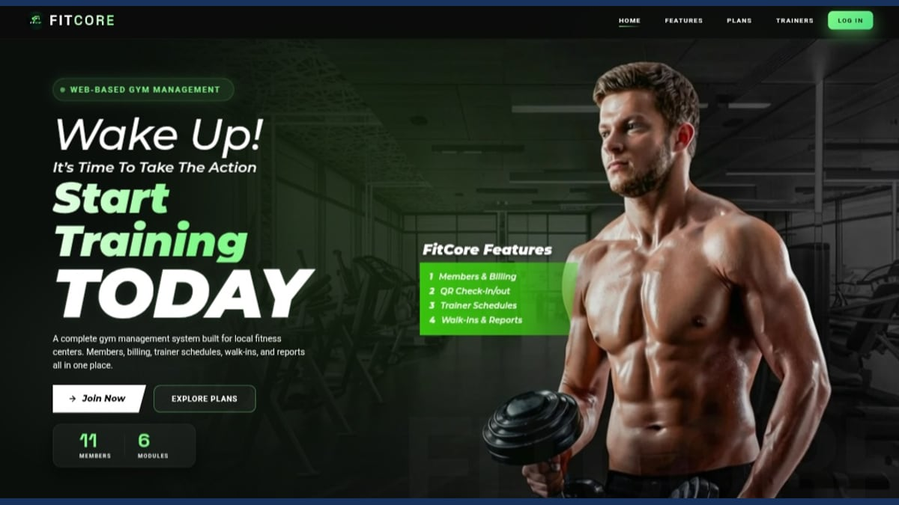</a>  
<strong>FitCore Gym Management</strong> 
Gym operations · JavaScript · Firebase 
 
</td>
<td width="50%" valign="top">
<a href="https://classcastmjdev.vercel.app">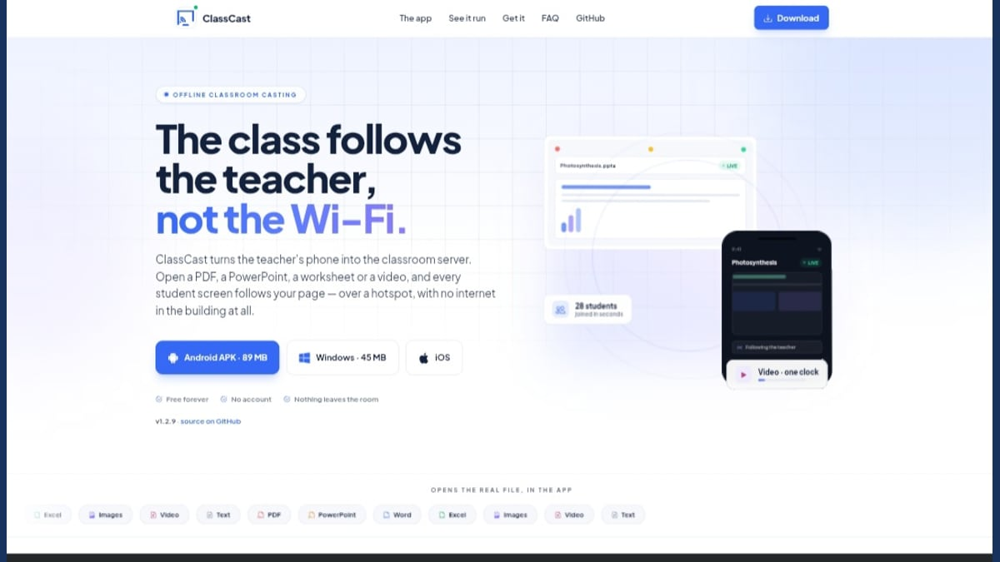</a>  
<strong>ClassCast</strong> 
Offline classroom · Flutter · WebSocket 
 
</td>
</tr>
<tr>
<td width="50%" valign="top">
<a href="https://johnfoodland.vercel.app">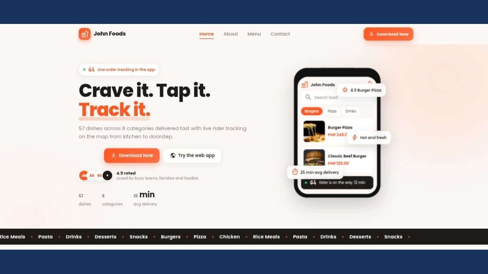</a>  
<strong>Johnfood Delivery</strong> 
Food ordering · Flutter · Firebase 
 
</td>
<td width="50%" valign="top">
<a href="https://merjohnpagente.github.io/-regex-challenge-game/">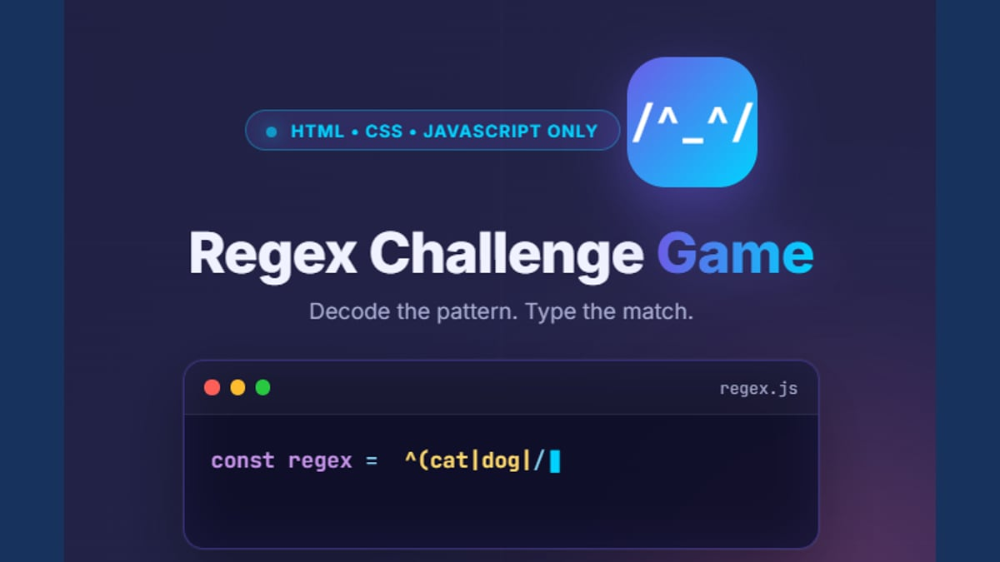</a>  
<strong>Regex Challenge Game</strong> 
Learning game · HTML · CSS · JavaScript 
 
</td>
</tr>
<tr>
<td width="50%" valign="top">
<a href="https://merjohnpagente.github.io/MOMENTUM/">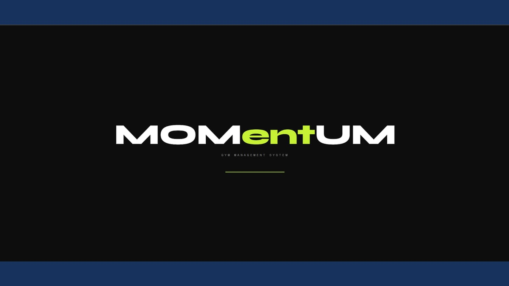</a>  
<strong>Momentum</strong> 
Gym operations · HTML · JavaScript · localStorage 
 
</td>
<td width="50%" valign="top">
<a href="https://merjohnpagente.github.io/spotify/">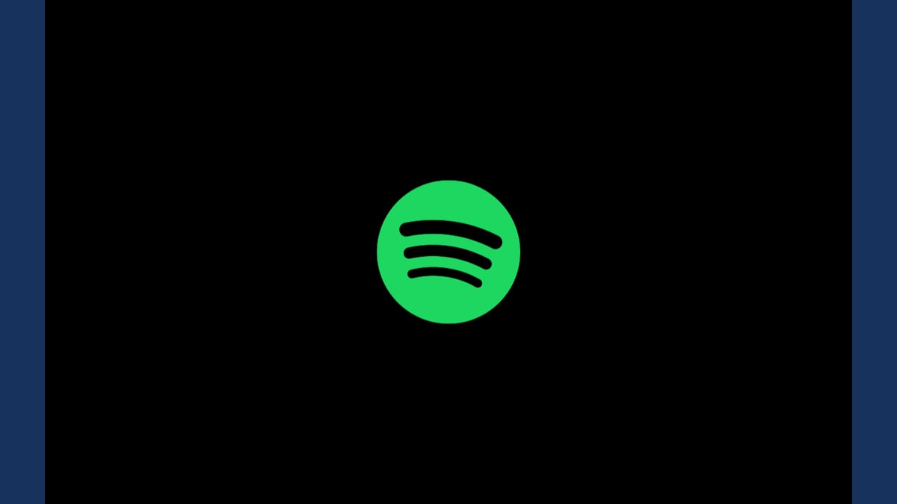</a>  
<strong>Spotify</strong> 
Streaming UI · Flutter · Node.js · MongoDB 
 
</td>
</tr>
</table>

**Also in the portfolio:** [Gorilla Gym](https://merjohnpagente.github.io/gorillagymapp/) — a Flutter gym management app built around Strength · Focus · Discipline.

## My portfolio

  <a href="https://merjohnpagente.github.io/">
    
  </a>

## Tech stack

**Frontend**

  
  
  
  
  
  

**Mobile**

  
  
  

**Backend and data**

  
  
  
  
  
  
  
  

**Tools**

  
  
  
  
  

## A year of shipping

  

  
  

  <picture>
    <source media="(prefers-color-scheme: dark)" srcset="https://raw.githubusercontent.com/merjohnpagente/MerjohnPagente/output/github-contribution-grid-snake-dark.svg"/>
    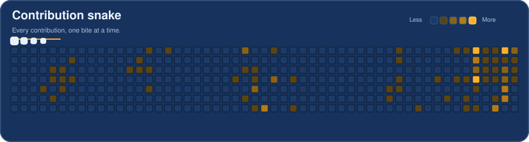
  </picture>

## Let's connect

Have a project, a role to fill, or just want to talk code? My inbox is open.

  
  
  

Thanks for stopping by. Say hi if you want to build something together.

